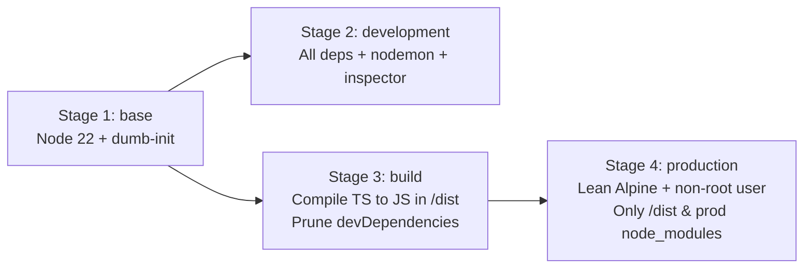

# 🐳 Docker & NestJS Mastery Template

> **A comprehensive reference repository for mastering Docker, NestJS, Multi-Stage Builds, PostgreSQL, MongoDB, Redis, Nodemon, Nginx, and AWS Production Architecture.**

---

## 📑 Table of Contents
1. [Architecture Overview](#-architecture-overview)
2. [Tech Stack Breakdown](#-tech-stack-breakdown)
3. [Multi-Stage Dockerfile Explained](#-multi-stage-dockerfile-explained)
4. [Development vs. Production Stages](#-development-vs-production-stages)
5. [Quickstart Guide](#-quickstart-guide)
6. [API Endpoints & Verification](#-api-endpoints--verification)
7. [Database & Redis Initialization](#-database--redis-initialization)
8. [Nginx Reverse Proxy & Security](#-nginx-reverse-proxy--security)
9. [AWS Cloud Deployment Path](#-aws-cloud-deployment-path)
10. [Useful Commands & Shell Access](#-useful-commands--shell-access)

---

## 🏛 Architecture Overview

```
                                      [ CLIENT REQUESTS ]
                                               │
               ┌───────────────────────────────┴───────────────────────────────┐
               ▼                                                               ▼
   [ DEVELOPMENT ENVIRONMENT ]                                     [ PRODUCTION SIMULATION ]
     docker-compose.yml                                            docker-compose.prod.yml
               │                                                               │
               │                                                    ┌──────────┴──────────┐
               │                                                    │ Nginx Reverse Proxy │ (Port 80)
               │                                                    │ (Rate Limit / Gzip) │
               │                                                    └──────────┬──────────┘
               │                                                               │ (Internal)
               ▼                                                               ▼
      ┌─────────────────┐                                             ┌─────────────────┐
      │  NestJS (Dev)   │                                             │  NestJS (Prod)  │
      │  nodemon watch  │ (Port 3000 & 9229)                          │  dist/main.js   │ (Private Net)
      │  volume mounted │                                             │  non-root user  │
      └────────┬────────┘                                             └────────┬────────┘
               │                                                               │
               ├───────────────────────────────┬───────────────────────────────┤
               ▼                               ▼                               ▼
      ┌─────────────────┐             ┌─────────────────┐             ┌─────────────────┐
      │   PostgreSQL    │             │     MongoDB     │             │      Redis      │
      │  (Relational)   │             │   (Documents)   │             │ (Cache/PubSub)  │
      │  TypeORM / UUID │             │ Mongoose Schema │             │  ioredis / LRU  │
      └─────────────────┘             └─────────────────┘             └─────────────────┘
```

---

## 🛠 Tech Stack Breakdown

- **Backend Framework**: [NestJS 10](https://nestjs.com/) (TypeScript)
- **Relational Database**: [PostgreSQL 16](https://www.postgresql.org/) managed via `@nestjs/typeorm` + `pg`
- **Document Database**: [MongoDB 7.0](https://www.mongodb.com/) managed via `@nestjs/mongoose` + `mongoose`
- **In-Memory Cache**: [Redis 7](https://redis.io/) accessed via `ioredis` with automatic exponential backoff
- **Live Reloading (Dev Only)**: `nodemon` watching TypeScript sources with polling for Docker compatibility
- **Reverse Proxy**: [Nginx 1.25 Alpine](https://nginx.org/) with gzip, security headers, and rate limiting
- **Cloud Readiness**: AWS ECS Fargate task definitions, Amazon ECR CodeBuild pipeline, and AWS App Runner config

---

## 📦 Multi-Stage Dockerfile Explained

The [Dockerfile](Dockerfile) uses a **4-stage multi-stage build** pattern. Multi-stage builds solve the classic Docker dilemma: *how to have development tools (compilers, linters, nodemon) during development, without bloating and compromising the security of the production image.*



### Stage Summary

| Stage | Target Name | Purpose | Image Size / Footprint |
|---|---|---|---|
| **1. Base** | `base` | Installs Alpine OS packages (`dumb-init`) and sets the working directory. | Minimal foundation |
| **2. Development** | `development` | Installs `dependencies` + `devDependencies`. Starts `nodemon` with debugging support on port 9229. | Larger (~800MB), includes build toolchains |
| **3. Build** | `build` | Runs `npm run build` to generate `dist/` and runs `npm prune --omit=dev`. | Intermediate discardable container |
| **4. Production** | `production` | Copies only `dist/` and production `node_modules`. Runs as non-root user `node`. | Ultralight (~180MB), hardened security |

---

## ⚖ Development vs. Production Stages

| Feature | Development (`docker-compose.yml`) | Production (`docker-compose.prod.yml`) |
|---|---|---|
| **Docker Stage** | `development` | `production` |
| **Process Runner** | `nodemon` (ts-node live reload) | `node dist/main.js` (Compiled JavaScript) |
| **Signal Handling**| `dumb-init` | `dumb-init` (Proper SIGTERM / SIGINT shutdown) |
| **Source Code** | Bind-mounted from host (`./src`) | Baked directly into the image |
| **Database Ports** | Exposed to host (`5432`, `27017`, `6379`) | **Hidden inside private bridge network** |
| **Public Gateway** | Direct access to NestJS on port 3000 | **Nginx Reverse Proxy on port 80** |
| **User Privileges**| Standard developer user | Non-root unprivileged `node` user |
| **Resource Limits**| Unlimited (host allocation) | Hard limits configured (e.g. 512MB RAM, 1 CPU) |

---

## 🚀 Quickstart Guide

### 1. Prerequisites
- Docker & Docker Compose (`docker -v`, `docker compose version`)
- Make (optional, but convenient)

### 2. Environment Setup
The project comes with a default `.env` ready to run. To inspect or customize:
```bash
cp .env.example .env
```

### 3. Launch Development Mode (Hot-Reload with Nodemon)
```bash
# Using Makefile:
make dev-build

# Or standard Docker Compose:
docker compose up --build
```
> **What happens?**
> 1. PostgreSQL, MongoDB, and Redis containers start first.
> 2. Docker waits for their internal health checks (`service_healthy`) to pass.
> 3. NestJS starts with `nodemon`. Any edit you make in `src/` instantly reloads without rebuilding the image!

### 4. Launch Production Simulation Mode (with Nginx)
```bash
# Using Makefile:
make prod

# Or standard Docker Compose:
docker compose -f docker-compose.prod.yml up --build -d
```
> **What happens?**
> 1. The multi-stage build compiles TypeScript into `/dist` and prunes devDependencies.
> 2. Nginx launches as the front-facing proxy on port 80.
> 3. The databases run in an isolated internal network without exposing ports to your machine.

---

## 📡 API Endpoints & Verification

Once running, verify each service using `curl` or Postman:

### 1. Unified Health Check
```bash
curl http://localhost:3000/api/v1/health
```
**Sample Response:**
```json
{
  "status": "healthy",
  "timestamp": "2026-10-17T12:00:00.000Z",
  "uptimeSeconds": 42,
  "environment": "development",
  "nodeVersion": "v22.17.1",
  "services": {
    "postgres": { "status": "up", "message": "Connected to PostgreSQL" },
    "mongodb": { "status": "up", "message": "Connected to MongoDB" },
    "redis": { "status": "up", "response": "PONG" }
  }
}
```

### 2. PostgreSQL (TypeORM Users CRUD)
```bash
# Create a user
curl -X POST http://localhost:3000/api/v1/users \
  -H "Content-Type: application/json" \
  -d '{"email":"alice@example.com","name":"Alice Wonder","role":"admin"}'

# List users
curl http://localhost:3000/api/v1/users
```

### 3. MongoDB (Mongoose Audit Logs)
```bash
# Create an audit log
curl -X POST http://localhost:3000/api/v1/logs \
  -H "Content-Type: application/json" \
  -d '{"action":"USER_SIGNUP","level":"INFO","details":"New registration","metadata":{"source":"mobile"}}'

# Fetch audit logs
curl http://localhost:3000/api/v1/logs
```

### 4. Redis (In-Memory Key/Value with TTL)
```bash
# Store key with 60 second TTL
curl -X POST http://localhost:3000/api/v1/cache \
  -H "Content-Type: application/json" \
  -d '{"key":"token:abc","value":{"userId":"123","scope":"read:all"},"ttlSeconds":60}'

# Retrieve key
curl http://localhost:3000/api/v1/cache/token:abc

# Delete key
curl -X DELETE http://localhost:3000/api/v1/cache/token:abc
```

---

## 🗄 Database & Redis Initialization

Each database includes an automated bootstrap script executed on first container creation:

1. **PostgreSQL**: [docker/postgres/init.sql](docker/postgres/init.sql)
   - Enables `uuid-ossp` extension.
   - Prepares schema and seeds default admin user.
2. **MongoDB**: [docker/mongo/init.js](docker/mongo/init.js)
   - Creates the `audit_logs` collection.
   - Generates performance indexes on `createdAt` and `level`.
   - Inserts initial initialization log entry.
3. **Redis**: [docker/redis/redis.conf](docker/redis/redis.conf)
   - Configures `allkeys-lru` eviction policy.
   - Enables hybrid RDB snapshotting + AOF persistence for high durability.

---

## 🛡 Nginx Reverse Proxy & Security

Located in [nginx/default.conf](nginx/default.conf):
- **Rate Limiting**: Protects your NestJS container from DDoS (configured for 20 req/sec with burst buffer of 40).
- **Security Headers**: Injects `X-Frame-Options`, `X-Content-Type-Options: nosniff`, and `X-XSS-Protection`.
- **Gzip Compression**: Compresses JSON payloads and static text automatically.
- **Upstream Forwarding**: Preserves `X-Forwarded-For`, `X-Forwarded-Proto`, and real client IPs.

---

## ☁ AWS Cloud Deployment Path

The project includes an **AWS Deployment Toolkit** inside the [`aws/`](aws/) directory:

- [aws/README.md](aws/README.md): Step-by-step roadmap for AWS ECS Fargate, ECR, RDS, and ElastiCache.
- [aws/ecs-task-definition.json](aws/ecs-task-definition.json): Production ECS Fargate task definition with AWS Secrets Manager integrations and CloudWatch logging.
- [aws/buildspec.yml](aws/buildspec.yml): AWS CodeBuild specification for multi-stage building and automated ECR pushing.
- [aws/apprunner.yaml](aws/apprunner.yaml): Direct config for deploying to AWS App Runner.

---

## 💻 Useful Commands & Shell Access

You can interact directly with the running containers using `make` or `docker compose exec`:

```bash
# NestJS Container Shell
make shell-api
# or: docker compose exec api sh

# PostgreSQL Terminal (psql)
make shell-postgres
# or: docker compose exec postgres psql -U postgres_user -d nest_docker_db

# MongoDB Terminal (mongosh)
make shell-mongo
# or: docker compose exec mongodb mongosh -u mongo_user -p mongo_secure_password --authenticationDatabase admin nest_mongo_db

# Redis Terminal (redis-cli)
make shell-redis
# or: docker compose exec redis redis-cli -a redis_secure_password

# View all container logs
make logs

# Stop and wipe volume data cleanly
make clean
```
